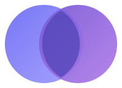

<div align="center">



# Project SAI

**관계마다 필요한 도구를 골라, 가구와 연결하는 공유 공간 서비스**

[](https://openjdk.org/projects/jdk/21/)
[](https://spring.io/projects/spring-boot)
[](https://vuejs.org/)
[](https://www.postgresql.org/)
[](LICENSE)

</div>

---

## 한눈에 보기

SAI는 **공간(Space)** 이라는 단위로 사람을 모으는 서비스입니다.
사용자는 자신의 공간을 만들고, 함께하고 싶은 사람에게 초대장을 보냅니다.
초대를 받은 사람이 수락하면 그 공간의 멤버가 됩니다. 공간 홈은 따뜻한 3D 방으로 표현하고, 가구에 일정·기록·할 일·정산 같은 기능을 연결합니다. 여행·모임·스터디는 공간 안의 이벤트로 만들고 필요한 도구를 선택합니다.

```text
메인 소개 ─▶ 회원가입 / 로그인 ─▶ 내 공간 ─▶ 3D 방 / 이벤트 / 도구
                                    └─ 공간 생성 · 멤버 초대 · 방 꾸미기
```

세션(`JSESSIONID`) 기반 인증을 사용하며, 공간마다 멤버에게 `OWNER` · `MANAGER` · `MEMBER` 역할이 부여됩니다.
초대는 아이디 검색 초대와 링크 초대 두 가지입니다. 대기 중 중복 초대와 동시 수락은 DB 제약으로 막고 409로 응답합니다. 역할별 아이디 초대 권한은 아직 정하지 않았습니다(링크 초대는 소유자·관리자만).

> 학습 목적으로 개발 중인 개인 프로젝트입니다. 로그인한 계정의 공간 내용(활동·도구·Foot Print)은 서버에 저장되어 멤버 모두가 함께 봅니다. 로그인 없이 보는 독립 목업만 브라우저 데이터를 씁니다.

## 구현 상태

2026-11-05 기준입니다. ✅ 서버에 저장되어 멤버가 함께 씀 · 🟡 일부 · ⏳ 아직 없음

| 영역 | 기능 | 상태 |
| --- | --- | :---: |
| 계정 | 회원가입, 로그인·로그아웃, 세션 | ✅ |
| 계정 | 이름 바꾸기, 비밀번호 바꾸기, 탈퇴(혼자인 공간 삭제·개인정보 비움) | ✅ |
| 계정 | 비밀번호 찾기(이메일), 카카오 로그인 | ⏳ |
| 공간 | 만들기(관계·색 선택, 관계별 기본 기능), 이름·관계·색 바꾸기, 삭제 | ✅ |
| 공간 | 멤버 목록, 공간별 닉네임, 역할 변경, 소유권 넘기기, 내보내기, 나가기 | ✅ |
| 초대 | 아이디 검색 초대, 받은 초대함 수락·거절 | ✅ |
| 초대 | 링크 초대(7일 유효·폐기), 링크로 가입 후 바로 참여 | ✅ |
| 소통 | 공지(고정), 활동·사진 댓글 | ✅ |
| 소통 | 이모지 반응, @멘션, 실시간 채팅 | ⏳ |
| 알림 | 알림함, 공간별 최근 소식, 안 읽은 수(헤더·공간 목록·메뉴·가구 배지) | ✅ |
| 알림 | 푸시 알림, 공간별 알림 끄기 | ⏳ |
| 콘텐츠 | 활동, 기록, 할 일, 일정, 여행 일정, 장소, 준비물, 정산, 투표 | ✅ |
| 콘텐츠 | 사진첩(올리기·활동 연결·설명·원본 받기·지우기) | ✅ |
| 관계 도구 | 기념일 D-day·위시리스트(연인), 회비·출석(동아리) | ✅ |
| 기억 | Foot Print(사진 고르기·한 줄 후기·게시), 기념품이 3D 방 선반에 놓임 | ✅ |
| 방 | 8×8 가구 배치·회전·충돌 검사, 서버 저장·버전 충돌 | ✅ |
| 방 | 공간 색이 벽·러그에 반영, 새 소식 가구 배지 | ✅ |
| 방 | 관심사 테마 팩(축구 등), 기념품 보관함 화면 | ⏳ |
| 운영 | 이용약관·개인정보 처리방침, 신고·차단, 운영자 화면 | ⏳ |

## 현재 화면에서 할 수 있는 일

- **공간 만들기:** 이름과 관계(연인·친구·동아리·직접 구성), 두 원의 색을 고릅니다. 관계에 맞는 기능이 먼저 켜집니다. 연인은 달력·기념일·위시리스트, 친구는 투표·정산, 동아리는 출석·회비·할 일로 시작합니다.
- **사람 모으기:** 사람 메뉴에서 초대 링크를 만들어 단톡방에 올립니다. 링크를 연 사람은 로그인하거나 가입한 뒤 바로 공간에 들어옵니다. 연인 공간에 들어온 사람은 관리자가 됩니다.
- **함께 쓰기:** 활동과 도구의 내용은 서버에 저장되어 멤버 모두가 봅니다. 두 사람이 동시에 저장하면 나중 저장이 최신 내용을 다시 받아 같은 변경을 한 번 더 적용합니다. 다른 멤버의 변경은 45초마다, 그리고 탭으로 돌아올 때 반영됩니다.
- **소식과 알림:** 멤버가 무언가를 추가·수정하면 소식이 쌓입니다. 헤더의 알림, 공간 목록, 메뉴, 해당 가구에 안 읽은 수가 표시되고 공간에 들어가면 읽음으로 바뀝니다.
- **공지와 댓글:** 소유자·관리자가 공지를 올리고 하나를 고정합니다. 고정 공지는 공간 홈 위에 보입니다. 활동과 사진에는 누구나 댓글을 남깁니다.
- **사진첩:** 여러 장을 한 번에 올리고(장당 10MB, JPG·PNG·WEBP·GIF), 활동에 연결하고, 원본을 받을 수 있습니다. 파일 형식은 내용으로 확인합니다.
- **Foot Print와 기념품:** 활동을 완료하면 Foot Print를 만들 수 있습니다. 활동 사진을 고르고, 멤버마다 한 줄 후기를 남기고, 기념품을 골라 게시합니다. 폴라로이드·액자·아크릴 스탠드는 고른 사진이 들어가고, 조개·랜턴·트로피 등은 물건으로 놓입니다. 기념품은 방 왼쪽 벽 선반에 놓이고 누르면 그 기록이 열립니다.
- **방:** 가구에 기능을 연결하고, 공간 색이 벽과 러그에 들어갑니다. 새 소식이 있는 기능의 가구에는 숫자 배지가 붙습니다.
- **계정:** 이름·비밀번호를 바꾸고 탈퇴할 수 있습니다. 소유자인 공간에 다른 멤버가 있으면 먼저 소유권을 넘겨야 합니다.

예전에 이 브라우저에 저장한 체험 데이터가 있고 서버 공간이 비어 있으면, 공간 홈에서 명시적으로 가져올 수 있습니다. 자동으로 올리지 않습니다. 장소는 직접 입력이며 지도 검색 API는 없습니다. 정산·회비는 계산과 체크만 하고 실제 송금은 하지 않습니다.

[작업 공간 기능의 구조와 정책](docs/architecture/workspace.md)을 참고하세요.

## 서비스 방향과 디자인 자료

지속적으로 유지하는 **Space(공간)** 안에 여행·모임 등 특정 활동인 **Event(활동)** 를 두고 필요한 기능을 선택합니다. 활동과 기능 모듈은 프론트엔드 임시 데이터로 구현했으며, 관련 서버 API는 다음 단계입니다.

| 기획 요소 | 현재 상태 |
| --- | --- |
| 활동 생성·완료·보관 | 프론트 임시 데이터로 동작 |
| 기록·할 일·일정, 선택형 기능 추가 | 프론트 임시 데이터로 동작 |
| 여행 일정·저장 장소·준비물·정산·투표 | 프론트 임시 데이터로 동작; 실제 지도 API는 예정 |
| 기록을 분석한 AI 기능 추천 | 향후 기능 예시 |
| 실시간 공동 편집 | 향후 기능 예시 |

- [현재 3D 방 인터랙티브 목업과 실행 방법](docs/mockups/room-interactive/README.md)
- [현재 3D 방 목업 검증](docs/mockups/room-interactive/verification.md)
- [3D 방 구조·저장 방식·에셋 라이선스](frontend/src/features/room/README.md)
- [서비스 기획서 v2](docs/planning/sai-product-plan-v2.md) — 2026-11-04 개정안. 관계 × 테마, 기념품, 로드맵을 정리했습니다. 최신 구현 범위는 이 README를 기준으로 합니다.
- [서비스 기획서 v1](docs/planning/sai-product-plan.md) — 초기 논의 기록입니다.

아래 자료는 이전 디자인과 검증 기록입니다.

- [PC 낮 테마 32장과 화면별 동작](docs/mockups/v3-pc-light/README.md)
- [32장 상호작용 설명](docs/mockups/v3-pc-light/interaction-guide.md)
- [간결한 디자인과 공간 상단 탭 변경 시안](docs/mockups/v4-clean-nav/README.md)
- [세부 기능 승인 시안 14장](docs/mockups/v5-local-features/README.md)
- [세부 기능 실제 구현 화면 17장과 검증 결과](docs/mockups/v5-local-features/implementation.md)
- [임시 데이터 구조와 백엔드 연결 준비](docs/architecture/frontend-local-content.md)

현재 `room-interactive` 목업은 조작 가능한 독립 화면입니다. 실제 Vue 프론트에도 3D 방과 공간 목록을 반영했습니다. 목업의 예시 계정·데이터는 실제 로그인 계정으로 이관되지 않습니다. 이전 목업 PNG에는 예정 기능이 포함되어 있으므로 최신 제품의 구현 증거로 보지 않습니다.

[실제 프론트 화면 캡처와 검증 결과](docs/mockups/v4-clean-nav/verification.md)를 확인할 수 있습니다. 화면 데이터는 검증용 모의 API 응답이며 실제 운영 데이터가 아닙니다.

## 기술 스택

**Backend** — Java 21 · Spring Boot 4.1 · Spring Web MVC · Spring Data JPA · Spring Validation · Spring Security Crypto(BCrypt) · Flyway · PostgreSQL · Lombok · Gradle 9.5.1(Wrapper)

**Frontend** — Vue 3 · TypeScript · Vite · Vue Router · Pinia · Three.js / WebGL · GLTFLoader · SUIT · Playwright · oxlint / ESLint / Prettier

## 빠른 시작

### 사전 준비

- JDK 21
- PostgreSQL
- Node.js `^22.18.0 || >=24.12.0`

Gradle은 저장소에 포함된 Wrapper를 사용하므로 따로 설치하지 않습니다.
(Spring Boot 4.1 · Java 21과 호환되지 않는 구버전 Gradle을 직접 지정하면 빌드가 실패합니다.)

### 1. 데이터베이스

```sql
CREATE DATABASE sai;
```

접속 정보는 `backend/src/main/resources/application.properties`에 있으며,
비밀번호는 소스에 두지 않고 `DB_PASSWORD` 환경 변수로 전달합니다.

```properties
spring.datasource.url=jdbc:postgresql://localhost:5432/sai
spring.datasource.username=postgres
spring.datasource.password=${DB_PASSWORD}
```

첫 실행 시 Flyway가 `backend/src/main/resources/db/migration`의 스크립트로 테이블을 생성합니다.

### 2. 백엔드 실행 → http://localhost:8080

```bash
cd backend
export DB_PASSWORD="본인의 PostgreSQL 비밀번호"
./gradlew bootRun
```

<details>
<summary>Windows PowerShell</summary>

```powershell
cd backend
$env:DB_PASSWORD = "본인의 PostgreSQL 비밀번호"
.\gradlew.bat bootRun
```

</details>

### 3. 프론트엔드 실행 → http://localhost:5173

```bash
cd frontend
npm install
npm run dev
```

백엔드 주소는 `VITE_API_BASE_URL` 환경 변수로 바꿀 수 있으며, 기본값은 `http://localhost:8080`입니다.

### 4. 백엔드 없이 3D 목업 보기 → http://127.0.0.1:5192

저장소 루트에서 실행합니다. Python이 필요합니다.

```bash
python -m http.server 5192 --bind 127.0.0.1 --directory docs/mockups/room-interactive
```

목업은 예시 공간·이벤트·가구를 사용하며 실제 로그인·초대 요청을 보내지 않습니다. ES 모듈을 사용하므로 파일을 더블 클릭하지 말고 HTTP 서버로 엽니다. 실제 API를 사용하는 Vue 화면은 현재 백엔드 CORS 설정에 맞춰 `http://localhost:5173`으로 접속합니다.

### 데이터 저장 범위

| 데이터 | 저장 위치 | 공유 범위 |
| --- | --- | --- |
| 계정·공간·멤버·초대·초대 링크 | PostgreSQL | 서버 권한 기준 |
| 활동·도구·Foot Print | PostgreSQL `space_content` (JSONB, 버전) | 공간 멤버 |
| 공지·댓글·소식 | PostgreSQL `space_post`, `space_feed` | 공간 멤버 |
| 사진 | 파일은 `SAI_STORAGE_DIR`(기본 `backend/data/photos`), 정보는 `space_photo` | 공간 멤버 |
| 가구 배치 | PostgreSQL `space_room` (JSONB, 버전) | 공간 멤버 |
| 가구와 활동의 연결, 낮/저녁 | localStorage | 해당 계정·브라우저 |
| 독립 목업 | localStorage `sai-room-mock`, `sai-cottage-time` | 목업을 연 브라우저 |

WebGL 지원 브라우저가 필요하며 실제 모바일 GPU 성능은 검증하지 않았습니다.

## API

모든 응답은 JSON이며, 로그인 이후 요청에는 `JSESSIONID` 쿠키가 필요합니다.

### 인증 `/api/auth`

| Method | Path | 설명 |
| --- | --- | --- |
| `POST` | `/signup` | 회원가입 |
| `POST` | `/login` | 로그인, 세션 생성 후 `userId` 반환 |
| `POST` | `/logout` | 로그아웃, 세션 무효화 |
| `GET` | `/me` | 현재 로그인한 사용자 정보 |

```jsonc
// POST /api/auth/signup
{
  "name": "홍길동",
  "loginId": "hong1234",
  "password": "password123!",
  "phoneNumber": "010-1234-5678",
  "email": "hong@example.com"
}
```

### 공간 `/api/spaces`

| Method | Path | 설명 |
| --- | --- | --- |
| `POST` | `/` | 공간 생성 (요청자가 `OWNER`) |
| `GET` | `/my` | 참여 중인 공간 목록 — 제목, 역할, 멤버 수 |

### 사용자 `/api/users`

| Method | Path | 설명 |
| --- | --- | --- |
| `GET` | `/search?loginId=...` | 로그인 아이디 부분 검색, 최대 10명 (세션 필요; 초대 화면 연결) |

### 초대 `/api/invitations`

| Method | Path | 설명 |
| --- | --- | --- |
| `POST` | `/` | 초대 보내기 (`spaceId`, `inviteeUserId`) |
| `POST` | `/join` | 초대 수락 → 공간 멤버로 등록 |
| `POST` | `/deny` | 초대 거절 |
| `GET` | `/received` | 내가 받은 초대 목록 |
| `GET` | `/sent` | 내가 보낸 초대 목록 |

### 공간 관리 `/api/spaces/{spaceId}`

| Method | Path | 설명 |
| --- | --- | --- |
| `GET` · `PATCH` · `DELETE` | (공간 자체) | 공간 정보·이름·관계·색 / 삭제(소유자) |
| `GET` | `/members` | 멤버 목록 |
| `PATCH` | `/members/me` · `/members/{userId}` | 내 닉네임 / 역할 변경·소유권 넘기기(소유자) |
| `DELETE` | `/members/{userId}` | 내보내기 |
| `POST` | `/leave` · `/seen` | 나가기 / 소식 읽음 |
| `GET` · `POST` · `DELETE` | `/invite-links[/{linkId}]` | 초대 링크 목록·만들기·폐기(소유자·관리자) |
| `GET` · `PUT` | `/content` | 공유 콘텐츠(버전이 다르면 409) |
| `GET` · `POST` | `/notices` | 공지 |
| `GET` · `POST` | `/comments?target=` · `/comments` | 댓글 |
| `GET` | `/comment-counts` | 대상별 댓글 수 |
| `DELETE` | `/posts/{postId}` | 공지·댓글 지우기 |
| `GET` · `POST` | `/photos` | 사진 목록·올리기(multipart) |
| `GET` · `PATCH` · `DELETE` | `/photos/{photoId}[/file]` | 사진 파일·설명·지우기 |
| `GET` | `/feed` | 공간 최근 소식 |

### 그 밖의 API

| Method | Path | 설명 |
| --- | --- | --- |
| `GET` | `/api/spaces/overview` | 내 공간별 색·관계·안 읽은 수 |
| `GET` | `/api/feed` · `/api/feed/unread` | 알림함 / 공간·기능별 안 읽은 수 |
| `GET` · `POST` | `/api/invite-links/{token}[/join]` | 링크 미리보기(로그인 불필요) / 참여 |
| `PATCH` · `POST` · `DELETE` | `/api/account/profile` · `/password` · `/api/account` | 이름 / 비밀번호 / 탈퇴 |

## 데이터 모델

```text
users ──< space_member >── space
  │                          │
  └──< space_invitation >────┘
        inviter / invitee, status: PENDING · ACCEPTED · DENIED
```

| 테이블 | 설명 |
| --- | --- |
| `users` | 사용자 계정. `login_id` 유니크, 비밀번호는 해시로만 저장 |
| `space` | 공간 |
| `space_member` | 공간 참여 정보. `(user_id, space_id)` 유니크, `role` 보유 |
| `space_invitation` | 초대장. 초대자 · 피초대자 · 상태. 대기 중 중복은 부분 유니크 인덱스로 막음 |
| `space_content` · `space_room` | 공유 콘텐츠와 가구 배치. JSONB와 버전 |
| `space_invite_link` | 초대 링크 토큰·만료·폐기 |
| `space_post` · `space_feed` | 공지·댓글 / 소식(알림·배지의 원천) |
| `space_photo` | 사진 정보. 파일은 디스크 |

자세한 관계는 [`docs/database/ERD.puml`](docs/database/ERD.puml)을 참고하세요.

## 프로젝트 구조

```text
project-sai
├── backend                      Spring Boot 백엔드
│   └── src
│       ├── main/java/com/sai/backend
│       │   ├── auth             회원가입 · 로그인 · 세션
│       │   ├── space            공간 · 멤버 · 초대
│       │   ├── user             사용자 엔티티와 Repository
│       │   ├── common           설정과 세션 상수
│       │   └── global           전역 예외 처리
│       ├── main/resources
│       │   ├── application.properties
│       │   └── db/migration     Flyway 마이그레이션
│       └── test                 Service · Controller · Repository 테스트
├── frontend                     Vue 3 프론트엔드
│   └── src
│       ├── views                소개 · 로그인 · 회원가입 · 내 공간
│       ├── components           AppLogo, AuthLayout
│       ├── stores               Pinia (auth, spaces)
│       ├── services             API 클라이언트
│       ├── features/content     세부 기능 화면·모델·저장소·검증 계산
│       ├── features/room        3D 방 · 배치 모델 · 렌더러 · 라이선스
│       ├── styles/cottage.css    따뜻한 공간 디자인
│       └── router               라우팅과 인증 가드
└── docs
    ├── architecture             기술 스택 문서
    ├── database                 ERD
    ├── devlog                   개발 기록
    └── mockups                  디자인 시안·PNG·상호작용 설명 (예정 기능 포함)
```

## 테스트

```bash
# 백엔드 — 실제 PostgreSQL 연결이 필요합니다
cd backend
export DB_PASSWORD="본인의 PostgreSQL 비밀번호"
./gradlew test

# 프론트엔드
cd frontend
npm run build # 타입 검사와 프로덕션 빌드
npm run test:unit # 정산·날짜·저장소·배치·충돌 검사
npm run test:e2e
```

실제 서버로 전체 흐름을 확인하려면 백엔드(8080)와 Vite(5173)를 켠 뒤 실행합니다. 계정 두 개로 가입 → 공간 만들기 → 링크 초대 → 활동 공유 → 사진 → 알림 → 공지 → 댓글 → Foot Print 게시 → 방의 기념품 열기 → 역할 변경까지 진행합니다. 테스트 계정이 실제 DB에 남으니 개발용 DB에서만 실행하세요.

```bash
# frontend 디렉터리
node scripts/live-flow.cjs
```

프론트엔드 E2E 테스트에는 모의 API 응답을 사용하는 화면·요청 계약 검사가 포함되어 있습니다. 통과하더라도 실제 PostgreSQL과 백엔드가 연결된 전체 흐름의 검증을 대신하지 않습니다.

3D를 포함한 Chromium 검사는 별도 터미널에서 Vite를 켠 후 실행합니다.

```bash
# 터미널 1 — frontend 디렉터리
npm run dev -- --host 127.0.0.1 --port 5193

# 터미널 2 — frontend 디렉터리
npx playwright test --config playwright.cottage.config.ts
```

2026-10-06 구현 검증: 타입 검사·빌드, 단위 검사 18개, Chromium 화면·요청 계약·3D 테스트를 확인했습니다. 드래그, 경계·충돌 검사, 회전 저장·새로고침, 취소, 공간별 분리, 가구→이벤트 도구 이동, 모바일 폭 배치를 검사합니다. 백엔드는 이 프론트 변경에서 수정하지 않았으며 실제 DB 통합 검사와 모바일 GPU 검사는 실행하지 않았습니다. 3D 엔진은 공간 진입 시 지연 로딩하며 빌드에서 번들 크기 경고가 발생합니다.

## 문서

- [기술 스택](docs/architecture/stack.md)
- [ERD](docs/database/ERD.puml)
- [개발 기록](docs/devlog)
- [2026-10-06 · 3D 공간과 승인 로고 적용](docs/devlog/261006.md)

## 라이선스

프로젝트 코드는 [MIT](LICENSE)입니다. Three.js는 MIT, [Kenney Furniture Kit](https://kenney.nl/assets/furniture-kit)의 가구 모델은 CC0이며 사용 파일 옆에 라이선스를 포함합니다. Virtual Cottage 2는 분위기 참고이며 해당 게임의 에셋은 사용하지 않습니다.
